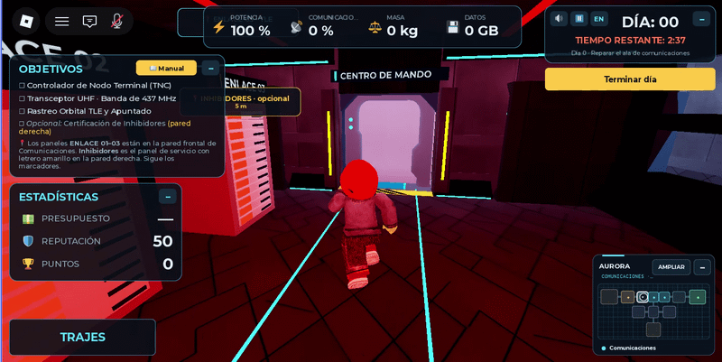

# Aurora Station: Space Mission VideoGame

Aurora Station is an videogame that simulates the process to design, handle and complete space mision.
As a prototype, this game is made from Roblox, with the possibility for expand more features, like spacecraft design and editing,
device crafting, more realistic physic simulation, land mission, among others.

## Game Overview
You stares in a Aurora spatial station, in above four days you will face missions/tasks where you see the results from  
experiment with some variable, like data calibration, cultivation monitoring, some rocket launch, and do observations from
telescope results.

## Roblox clause
Files, such as scene and gui configuration are from Roblox Studio in a collaborative workspace (which is handled via cloud) during the NASA Space Apps Event. When the project was finished, all these are uploaded to GitHub through third-party tools (Argon, as a tool for extract files ans sync to Roblox Studio).
